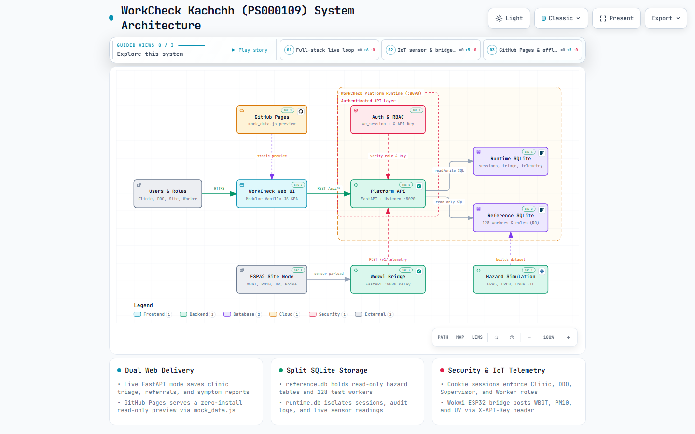

# WorkCheck Kachchh (PS000109)

**Digital Occupational Health Monitoring & Follow-Up Platform for Industrial Workers**  
Seva First Innovation Challenge 2026 / SSIP Gujarat — Problem Statement **PS000109** (District Development Office, Kachchh)

[](https://jaypatel29042008-glitch.github.io/WorkCheck-Kachchh-PS000109/)
[](https://jaypatel29042008-glitch.github.io/WorkCheck-Kachchh-PS000109/architecture.html)
[](https://fastapi.tiangolo.com/)
[](https://ssipgujarat.in/)
[](./LICENSE)

> **Data Honesty Notice:** This repository holds **no real Kachchh worker health records**. The 128 workers (`SIM-*`) are fictional test profiles, heat and UV figures are model estimates, and silica/noise tables come from external public datasets. Every dataset table carries its own provenance label. Alert rules track follow-up only and do not diagnose medical conditions.

---

## 🌐 Live Links (Zero Install)

| Resource | Live Link | Description |
| :--- | :--- | :--- |
| **Live Web Preview** | **[Open WorkCheck Kachchh](https://jaypatel29042008-glitch.github.io/WorkCheck-Kachchh-PS000109/)** | Zero-install read-only preview powered by a static snapshot (`js/mock_data.js`). Nothing entered is saved. Run the full-stack app below to persist triage, referrals, and live sensor data. |
| **Interactive System Architecture** | **[Explore Archify Diagram](https://jaypatel29042008-glitch.github.io/WorkCheck-Kachchh-PS000109/architecture.html)** | Standalone interactive architecture viewer with Light/Dark themes, 3 guided story views, pan/zoom/search, PNG/SVG/WebM export, and clickable GitHub source-code citations (`SRC`). |

---

## 🏗️ Interactive System Architecture

Click the diagram below to open the **live interactive Archify viewer** ([`architecture.html`](https://jaypatel29042008-glitch.github.io/WorkCheck-Kachchh-PS000109/architecture.html)) — built and showcase-validated from [`docs/architecture.archify.json`](./docs/architecture.archify.json):

<a href="https://jaypatel29042008-glitch.github.io/WorkCheck-Kachchh-PS000109/architecture.html" target="_blank" rel="noopener noreferrer">
  <picture>
    <source media="(prefers-color-scheme: dark)" srcset="./docs/architecture-preview-dark.png">
    <source media="(prefers-color-scheme: light)" srcset="./docs/architecture-preview-light.png">
    
  </picture>
</a>

### Guided Architecture Views Included
1. **Full-Stack Live Loop** — Role-scoped browser sessions (`wc_session`) routed through `WorkCheck Web UI` → `Platform API` (`FastAPI :8090`) → split SQLite (`runtime.db` for writes, `reference.db` read-only).
2. **IoT Sensor & Bridge Path** — `ESP32 Site Node` (Wokwi WBGT, PM10, UV, Noise simulation) → `Wokwi Bridge` (`FastAPI :8080`) → `POST /api/v1/telemetry` authenticated via `X-API-Key`.
3. **GitHub Pages & Offline ETL** — Zero-install read-only browser preview (`js/mock_data.js`) alongside the offline Python hazard simulation pipeline (`simulation/combine_and_simulate.py`).

---

## 👥 Role-Based Views & Demo Accounts

Both the [live read-only preview](https://jaypatel29042008-glitch.github.io/WorkCheck-Kachchh-PS000109/) and the local full-stack platform ship with four role-scoped demo accounts:

| Role | Email | Password | Capabilities |
| :--- | :--- | :--- | :--- |
| **Clinic Team** | `clinic@workcheck.demo` | `Demo-Clinic-2026` | Today's triage queue, all 128 test worker records, check result logging, symptom review, nearest-facility referral |
| **District Office (DDO)** | `ddo@workcheck.demo` | `Demo-DDO-2026` | Anonymous taluka totals, Kachchh heat & dust map, district CSV export (no individual worker PII) |
| **Site Supervisor** | `site@workcheck.demo` | `Demo-Site-2026` | Site hazard monitor, heat work/rest guidance, and simulated Wokwi ESP32 node controls |
| **Worker** | `worker@workcheck.demo` | `Demo-Worker-2026` | Personal health pass (`Kishan P.` / `SIM-B`), QR code, symptom reporting (with Gujarati & Hindi UI support), nearest facilities |

---

## 📊 Key Analytical Findings

Full quantitative analysis and evidence tables are documented in [`INSIGHTS.md`](./INSIGHTS.md), [`REPORT.md`](./REPORT.md), and [`charts/`](./charts/):

* **6:00 AM Shift Start Cuts Model Heat Danger by ~20%** — Shifting a 9:00 AM–6:00 PM schedule to 6:00 AM–3:00 PM avoids ~358 hazardous WBGT hours/year (19.9%) with the same 9-hour workday.
* **Coastal Humidity Trap & Nocturnal Heat Debt** — At Kandla and Mundra Ports, high coastal humidity pushes WBGT above heavy-work limits for over 2,000 modeled hours/year, with >54% of hot days followed by nights staying above 25 °C WBGT.
* **Shade Helps, But Cannot Solve Coastal Heat Alone** — Full shade drops modeled WBGT by 2.6 °C–2.8 °C (clearing 51.8%–65.3% of dangerous hours), yet 604–997 working hours remain hazardous even under shade.
* **15-Minute Dust Spikes vs. 8-Hour Averages** — In high-frequency concrete mixing traces, a 15-minute rolling window captures 81.8% of peak dust spikes that 8-hour averages dilute.

---

## 🚀 Quick Start (Full-Stack Local Mode)

Run the full-stack FastAPI server to enable live persistence (clinic updates, symptom reports, referrals, and telemetry writes):

```bash
cd workcheck_platform
python -m pip install -r requirements.txt
python -m uvicorn app.main:app --port 8090
```

Then open **http://localhost:8090** in your browser.
* **Windows shortcut:** double-click `workcheck_platform/run.bat` (or `run_website.bat`)
* **macOS shortcut:** double-click `workcheck_platform/run.command` (or `run_website.command`)

### Where Data Is Stored
| File | Access | Contents |
| :--- | :--- | :--- |
| `workcheck_platform/data/reference.db` | Read-only | Compiled PS000109 dataset: 128 fictional test workers, hazard tables, facility list, and routing rules |
| `workcheck_platform/data/runtime.db` | Read/Write | Created on first launch: hashed accounts, `wc_session` sessions, audit logs, clinic updates, symptom reports, and node telemetry |

To reset all demo writes, stop the server and delete `workcheck_platform/data/runtime.db`.

---

## 🔌 ESP32 / Wokwi IoT Bridge (Optional)

The optional hardware bridge connects a simulated Wokwi ESP32 node (or real device) to the platform's `/api/v1/telemetry` route:

```bash
cd wokwi_bridge
python -m pip install fastapi uvicorn httpx pytest
python -m uvicorn app:app --host 0.0.0.0 --port 8080
```

Interactive OpenAPI docs run at **http://localhost:8080/docs**. To test without Wokwi hardware, run the fake device simulator in a second terminal:

```bash
cd wokwi_bridge
python fake_device.py --url http://127.0.0.1:8080
```

See [`wokwi_bridge/README.md`](./wokwi_bridge/README.md) and [`workcheck_platform/wokwi/README.md`](./workcheck_platform/wokwi/README.md) for public tunnel setup, `BRIDGE_API_KEY` / `WC_DEVICE_KEY` headers, and Wokwi firmware patching.

---

## 📂 Repository Structure

| Path | Purpose |
| :--- | :--- |
| [`index.html`](./index.html), [`styles.css`](./styles.css), [`js/`](./js/), [`assets/`](./assets/) | Static read-only web preview deployed to GitHub Pages (using `js/mock_data.js`) |
| [`architecture.html`](./architecture.html), [`docs/architecture.archify.json`](./docs/architecture.archify.json) | Interactive Archify system architecture viewer (live on GitHub Pages) and its validated JSON specification |
| [`workcheck_platform/`](./workcheck_platform/) | Full-stack application: FastAPI backend (`app/main.py`), role auth, SQLite storage (`data/`), SPA assets (`static/`), Wokwi firmware (`wokwi/`), and tests (`tests/`) |
| [`wokwi_bridge/`](./wokwi_bridge/) | Standalone FastAPI IoT sensor relay (`app.py`), fake device tester (`fake_device.py`), and bridge tests (`test_bridge.py`) |
| [`simulation/`](./simulation/) | Multi-parameter occupational hazard simulation scripts (`combine_and_simulate.py`) and generated CSV outputs (`output/`) |
| [`final_dataset/`](./final_dataset/) | Empirical & modeled CSV datasets (ERA5 weather, CPCB PM10, UV, OSHA/MSHA/NIOSH reference tables, 128 simulated workers, data dictionary) |
| [`charts/`](./charts/) | High-resolution analytical plots for heat, compound hazards, shift rescheduling, shade, and dust traces |
| [`final_synopsis/`](./final_synopsis/) | PS000109 Final Synopsis documents (HTML & PDF) and [`WorkCheck_SFIC_Synopsis.pptx`](./WorkCheck_SFIC_Synopsis.pptx) |
| [`INSIGHTS.md`](./INSIGHTS.md), [`REPORT.md`](./REPORT.md), [`MASTER_DATA_GUIDE.md`](./MASTER_DATA_GUIDE.md) | Deep analytical write-ups, data provenance documentation, and methodology guides |

---

## 🧪 Automated Tests

Run both test suites from their respective directories:

```bash
# 1. Full-stack platform tests
cd workcheck_platform
python -m pytest tests -q

# 2. Wokwi IoT bridge tests
cd ../wokwi_bridge
python -m pytest test_bridge.py -q
```

---

## 🔒 Before Internet Deployment

Before exposing the full-stack platform publicly:
1. Enable `WC_SECURE_COOKIE=1` and serve strictly over HTTPS.
2. Configure a strong private `WC_DEVICE_KEY` (and `BRIDGE_API_KEY` if running the bridge).
3. Replace all local demo accounts (`*.demo`).
4. Review Gujarati/Hindi translations with a fluent speaker and have all alert thresholds clinically validated.

---

## 📜 Credits & License

* **Map Boundaries:** OpenStreetMap contributors (ODbL, simplified; not an official administrative boundary map).
* **Icons & Typography:** Tabler Icons (MIT), Plus Jakarta Sans & Noto Sans (OFL).
* **License:** Released under the [MIT License](./LICENSE) — Copyright © 2026 Jay Patel.
